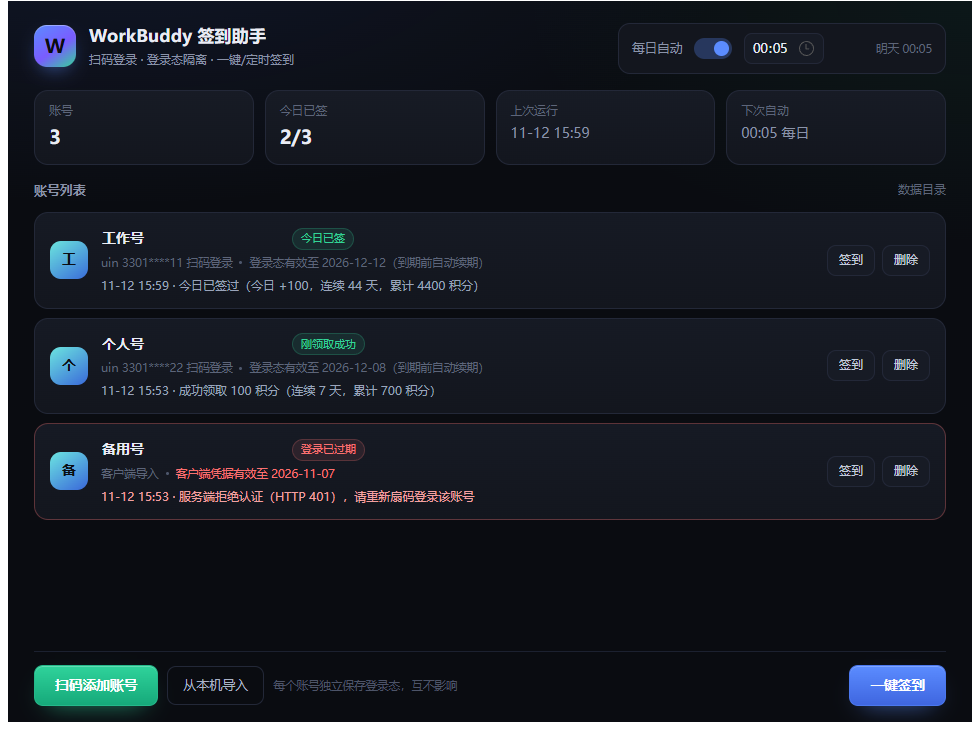
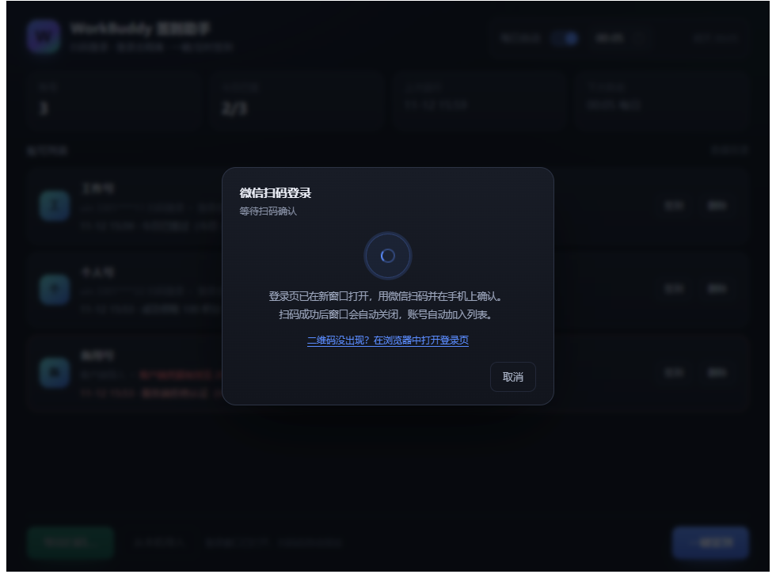

<div align="center">

# 🤖 WorkBuddy 签到助手

**微信扫码登录 · 多账号隔离 · 一键签到 · 每日定时 · Windows / macOS**

[](LICENSE)
[](../../releases)



</div>

## 这是什么

每天自动领取 **WorkBuddy**（腾讯 AI 编程助手，CodeBuddy 同源）的**签到积分**。

不用装 Python、不用配计划任务：下个包、扫个码就能用，想加几个账号就扫几次。

| 下载 | 说明 |
|---|---|
| [**WorkBuddySignin.exe**](../../releases) | Windows 10/11 x64，单文件，双击即用 |
| [**WorkBuddySignin.dmg**](../../releases) | macOS（Apple Silicon），拖进「应用程序」 |

> 首次运行可能被拦一下（产物未做 Apple 公证 / Windows 代码签名）：
> Windows 点「更多信息 → 仍要运行」；macOS 见下面[打不开怎么办](#macos-打不开怎么办)。

## 三步用起来

1. **扫码添加账号** —— 点左下角按钮，弹出**官方**登录页，微信扫码确认，账号自动进列表
2. **一键签到** —— 右下角按钮把所有账号签一遍；结果就地显示（已签 / 刚领取 / 失败 + 连签、累计积分）
3. **开定时** —— 右上角打开「每日自动」并选时间（默认 00:05），面板开着就每天自动签

关机、睡眠错过的，会在下次启动后补上。

## 功能

| | |
|---|---|
| 🔑 **扫码登录** | 走官方登录页，二维码由官方渲染，本程序不接触你的微信信息 |
| 👥 **多账号隔离** | 每号一份独立会话，登录态互不共享；删一个不影响其它 |
| ♻️ **自动续期** | 令牌临期自动用 refreshToken 换新，401 时续期后重试，不必反复扫码 |
| ⏰ **每日定时** | 到点自动签，错过会补跑 |
| 🚀 **开机自启** | Windows 注册表启动项 / macOS LaunchAgent |
| 🖥️ **纯本地** | 凭据只存本机（Windows 经 DPAPI 加密），不上传任何服务器 |

<details>
<summary>扫码登录长什么样</summary>



</details>

## 常见问题

| 现象 | 处理 |
|---|---|
| 提示「登录已过期」 | 该账号被服务端作废了（改密码 / 换设备 / 被踢），重新扫一次即可，其它号不受影响 |
| 扫码后没反应 | 确认手机微信点了「允许」；二维码约 5 分钟过期，过期就取消重来 |
| 定时没跑 | 面板得开着（或勾了开机自启）。错过的时间点在下次启动后补 |
| 杀软 / SmartScreen 拦截 | PyInstaller 未签名产物的常见情况。Windows 点「更多信息 → 仍要运行」 |
| macOS 提示「无法验证开发者」 | 见下面[打不开怎么办](#macos-打不开怎么办) |
| 想自己构建 | `打包exe.bat`（Windows）/ `bash 打包mac.sh`（macOS），需 Python 3.9+ 与 `pip install pywebview pyinstaller` |

更多（数据目录、日志、免界面自检）见 **[desktop/README.md](desktop/README.md)**。

### macOS 打不开怎么办

弹窗写的「Apple 无法验证是否包含恶意软件」不是在报毒，是因为这个包**没有 Apple 开发者签名和公证**——
自己用 PyInstaller 打的包都这样，签发证书是每年 $99 的事，本项目没买。解除方式任选一种：

**图形界面（推荐，适用于新版 macOS）**

1. 双击 App，弹窗点「完成」
2. 打开 **系统设置 → 隐私与安全性**，往下拉到「安全性」
3. 看到「已阻止使用 WorkBuddySignin，因为来自身份不明的开发者」，点 **仍要打开**
4. 输入密码，再双击一次 App，弹窗里这次会多出「打开」按钮

**终端（一步到位）**

```bash
# 先把 App 拖进「应用程序」，再执行
xattr -dr com.apple.quarantine /Applications/WorkBuddySignin.app
```

**老版本系统（macOS 14 及更早）**：按住 Control 点 App → 打开 → 弹窗里点「打开」。

如果提示的是「已损坏，无法打开」而不是「无法验证开发者」，也是同一原因（拷贝/dmg 挂载导致签名失效），
用上面的 `xattr` 命令即可，不要去点「移到废纸篓」。

## 命令行版

桌面版之外，仓库里仍是原项目那份自包含脚本 `signin.py`（签到 + 成长中心，含系统计划任务）。

```bash
python signin.py auto      # 签到 + 成长中心
python signin.py silent    # 同上，结果写日志（配合计划任务）
python signin.py status    # 只看今日是否已签
```

完整的模式对比、计划任务安装、成长中心原理、加密凭据解密等，见
**[原项目 README](https://github.com/88lin/workbuddy-auto-signin)**。

## 关于这个仓库

> [!IMPORTANT]
> **这是第三方 fork，不是原项目**。原作者 [88lin](https://github.com/88lin)，
> 签到接口逆向、加密凭据解密、重试与幂等逻辑都来自
> [workbuddy-auto-signin](https://github.com/88lin/workbuddy-auto-signin)（MIT）；
> 桌面面板（扫码登录、多账号、定时、打包）是本仓库新增的。
> 脚本层的问题请优先对照原项目文档。

本仓库**只做 WorkBuddy**：上游附带的 Qoder CN 脚本没有包含在内，需要请到原仓库取。

## 免责声明

> [!WARNING]
> 非官方工具，与腾讯、WorkBuddy、CodeBuddy 无任何隶属关系，也未获授权或背书。
> 签到与登录接口均系从官方客户端逆向得到，**随时可能变更且不另行通知**。
> 请仅用于领取**你自己账号**的每日积分，不要用于批量注册、刷积分、代签他人账号或商业用途；
> 使用风险自负，并请遵守相关服务条款与当地法律。

## 协议与致谢

[MIT](LICENSE) © 2026 [88lin](https://github.com/88lin)（原项目）· 桌面面板部分同样以 MIT 发布。

- [88lin/workbuddy-auto-signin](https://github.com/88lin/workbuddy-auto-signin) —— 签到接口、凭据解密、重试与幂等
- [AiForSoftware/wb-checkin](https://gitcode.com/AiForSoftware/wb-checkin) —— 扫码登录接口的公开实现参考
- [pywebview](https://pywebview.flowrl.com/) —— 桌面窗口外壳
